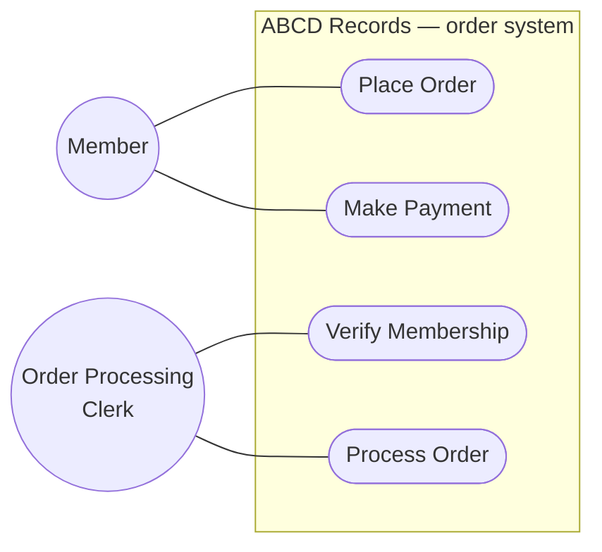
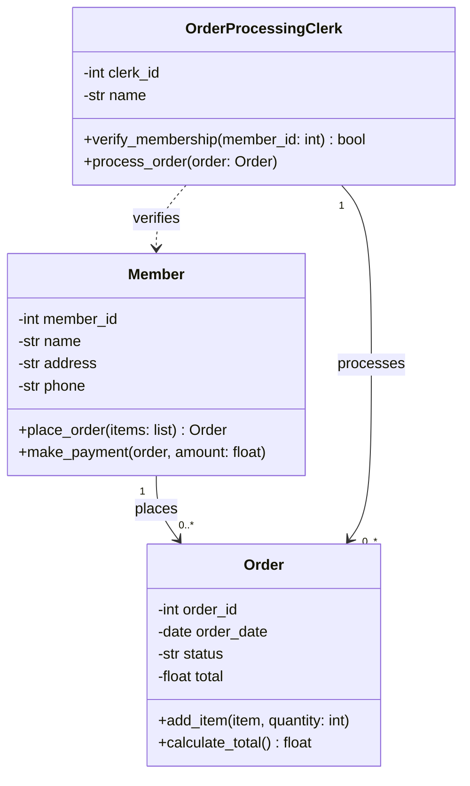
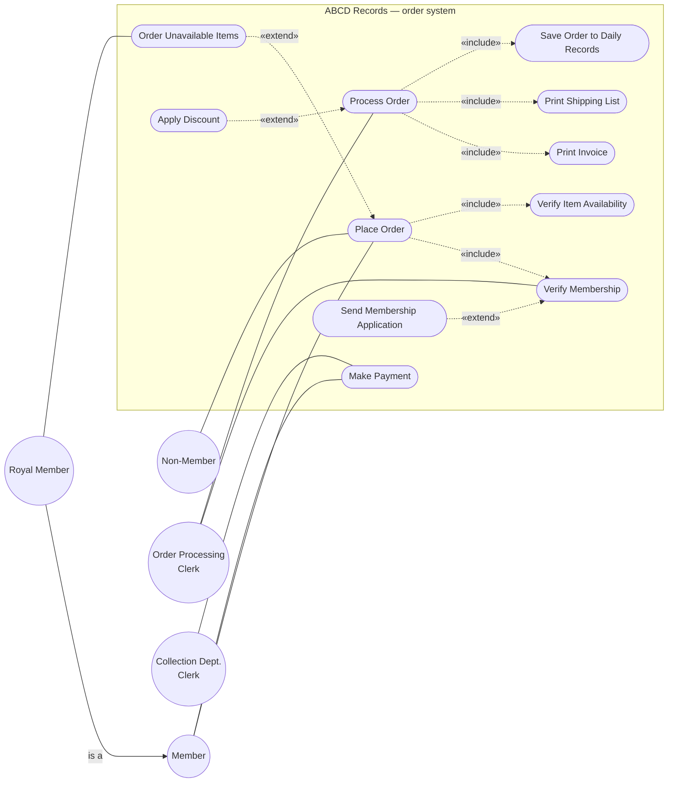
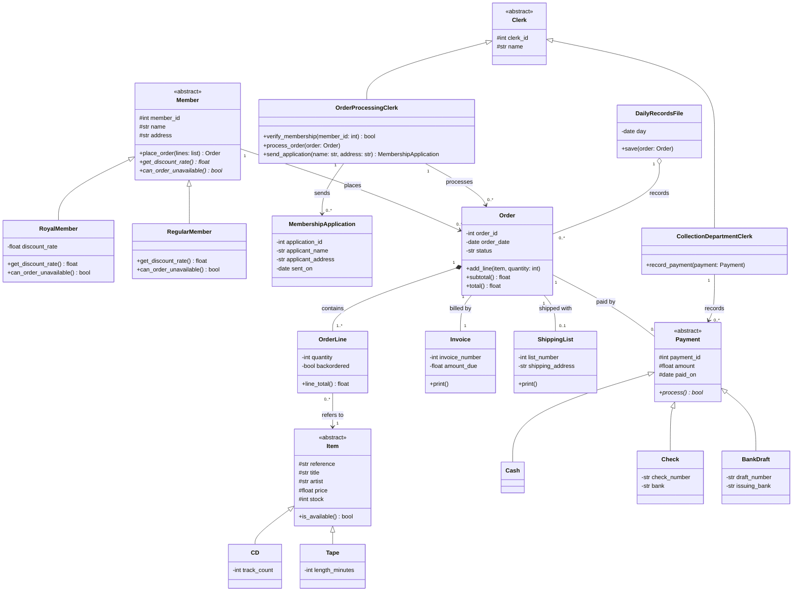
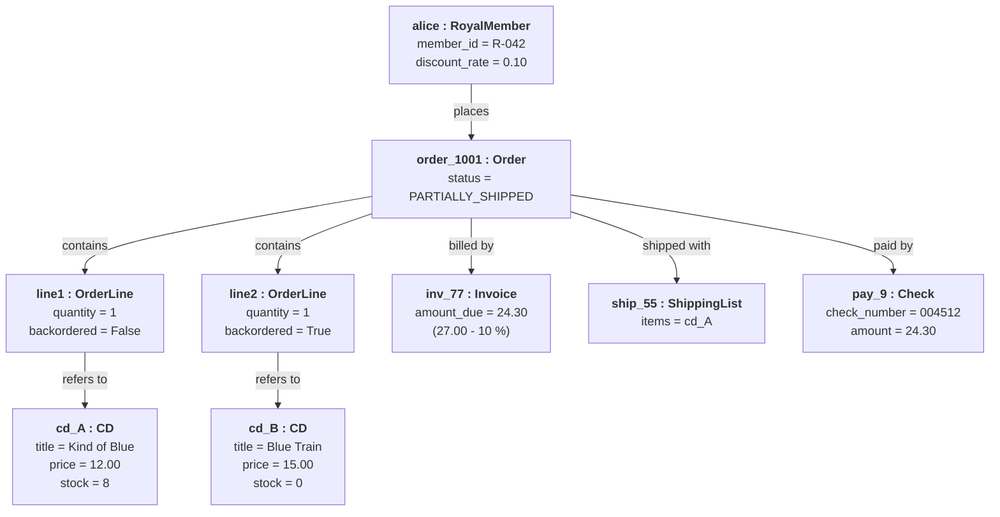
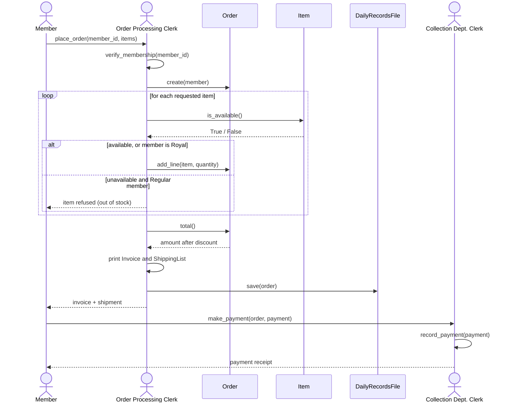
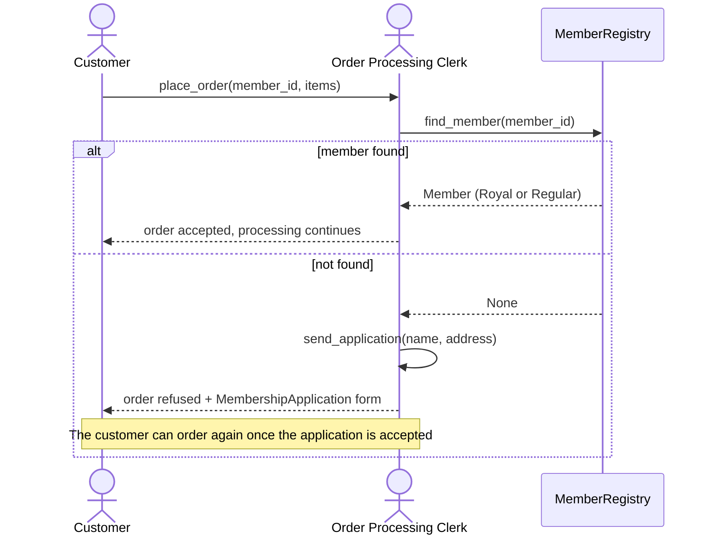
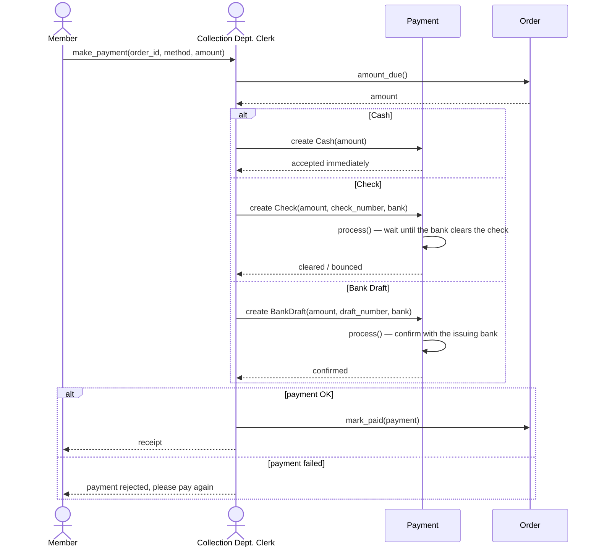
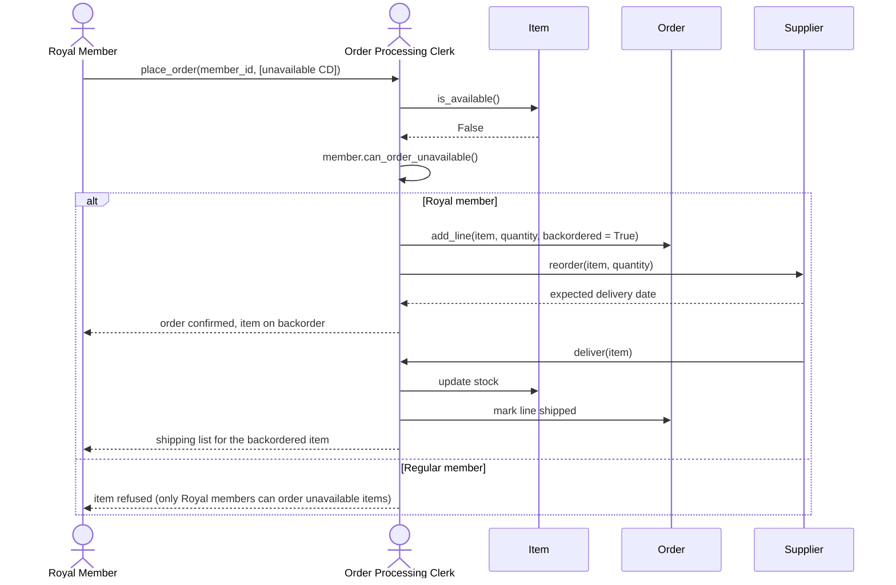

# Exo 2 — ABCD Records 📼

Mermaid has no native use case diagram, so use cases are drawn as a
flowchart: round nodes are actors, stadium-shaped nodes are use cases, and the
box is the system boundary. Dotted arrows are `«include»` / `«extend»`.

---

## Level 1

### Task 1.1 — Simple use case diagram

### Task 1.2 — Basic class diagram

---

## Level 2

### Task 2.1 — Complete use case diagram

How to read it:
- **«include»** = always done: placing an order always verifies membership and
  availability; processing always prints the invoice and shipping list and
  saves the order to the daily records file (rule 8).
- **«extend»** = done only under a condition, and the arrow goes from the
  optional case to the base case: the application form is sent only if the
  membership check fails (rule 2), unavailable items and discounts only for
  Royal members (rules 3 and 4).
- **Royal Member → Member** is an actor generalization: a Royal member can do
  everything a member does, plus order unavailable items.

### Task 2.2 — Complete class diagram

Design choices:
- `OrderLine` sits between `Order` and `Item` so one order can hold several
  items with a quantity each (composition: lines do not exist without their order).
- The difference between Royal and Regular members is behaviour
  (`get_discount_rate()`, `can_order_unavailable()`), so it is modelled with
  **polymorphism**, not with `if member_type == "royal"`.
- `ShippingList` is `0..1` because an order whose items are all unavailable
  has nothing to ship yet.

### Scenario — a Royal member orders 2 CDs (one unavailable) and pays by check

Object diagram (snapshot of the objects at the end of the scenario; the prices
and the 10 % Royal discount are example values).

Because Alice is a Royal member, `cd_B` is accepted even though `stock = 0`:
its line is marked `backordered = True`, and only `cd_A` is on the shipping list
for now. A Regular member's order line for `cd_B` would have been refused.

---

## Level 3 — Advanced sequence diagrams

### 1. Complete order processing flow

### 2. Membership verification (success and failure)

### 3. Payment processing (all types)

### 4. Item reordering for Royal members

