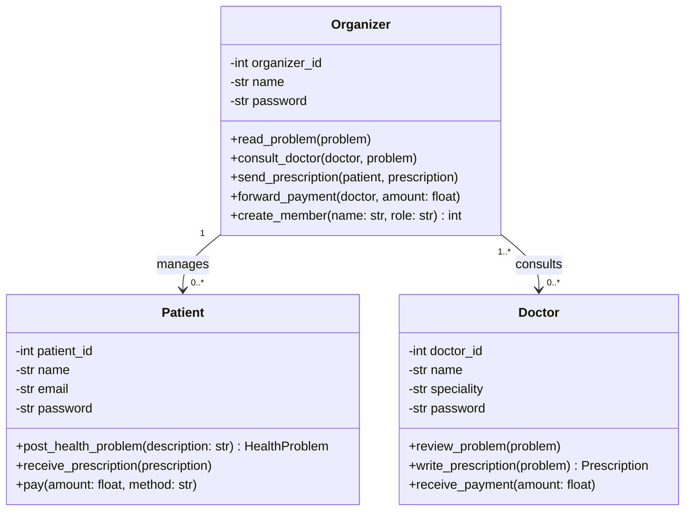
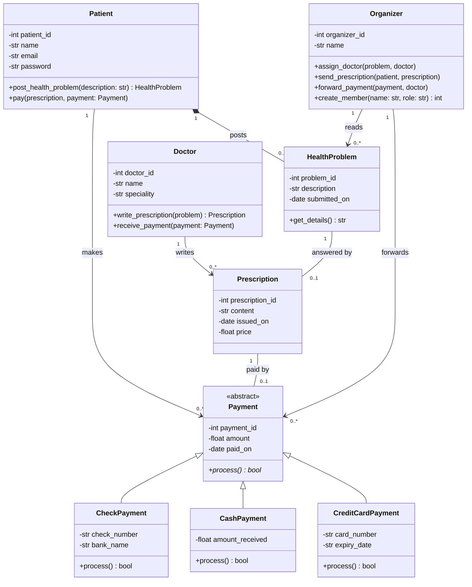
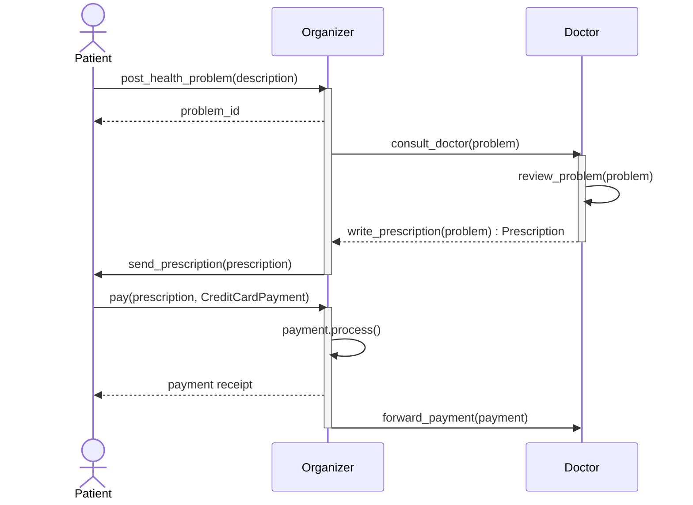
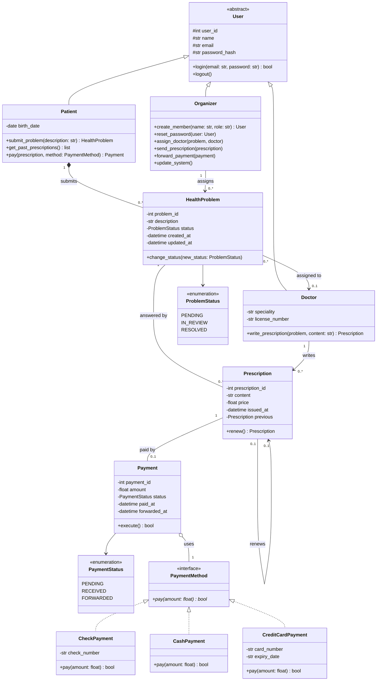
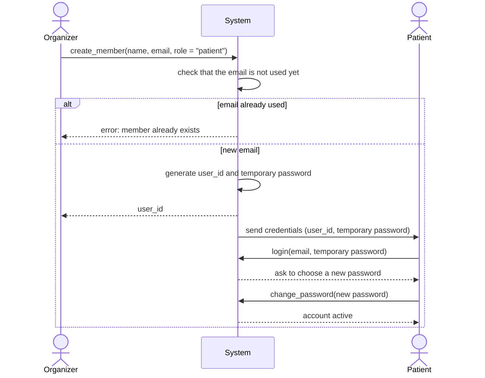
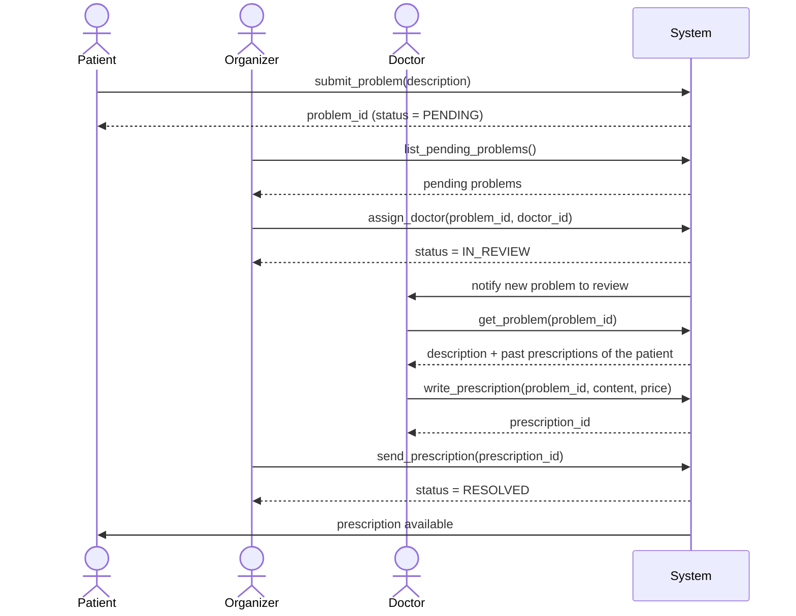
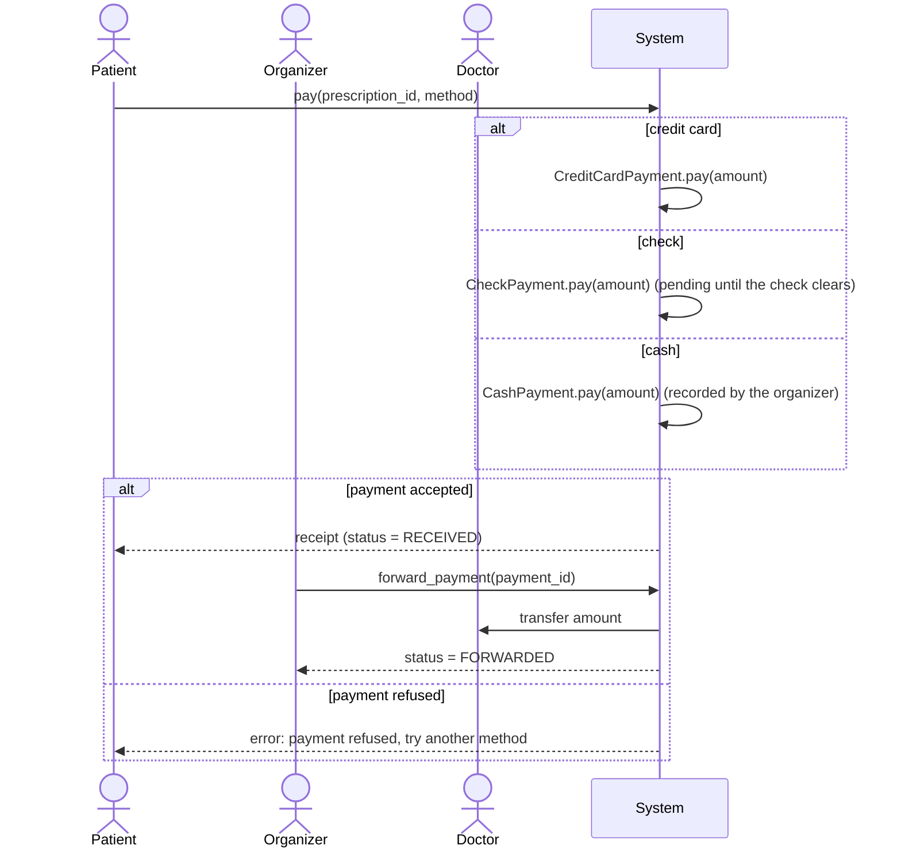

# Exo 1 — Hospital Management System 🏥

Diagrams are written in [Mermaid](https://mermaid.js.org/), so GitHub draws
them directly in this page.

---

## Task 1 — Basic class diagram (Patient, Doctor, Organizer)

**Reading the multiplicities:** one organizer manages any number of patients;
there is at least one organizer, and each organizer can consult several
doctors. Patients and doctors never talk directly: everything goes through the
organizer (steps 2 to 6 of the workflow).

---

## Task 2 — Complete class diagram (6 classes + payment types)

**Design choices:**
- **Composition** between `Patient` and `HealthProblem`: a health problem only
  exists for the patient who posted it (if the patient account is deleted, so
  are their problems).
- **Inheritance** for the payment types rather than an enumeration: each type
  needs its own data (check number, card number...) and its own way of being
  processed, so `process()` is abstract and redefined in each subclass.

### Sequence diagram — a patient submits a problem, receives a prescription and pays

---

## Task 3 — Advanced model

### Final class diagram

What changed compared with Task 2:
- **`User` superclass** holds what every actor shares (id, name, password,
  `login()` / `logout()`), so it is written only once.
- **Status tracking:** `HealthProblem.status` uses the `ProblemStatus`
  enumeration (`PENDING` → `IN_REVIEW` → `RESOLVED`); `Payment` has its own
  status (`PENDING` → `RECEIVED` → `FORWARDED`).
- **Timestamps** (`created_at`, `issued_at`, `paid_at`...) on every event.
- **Past prescriptions:** a prescription can point to the one it `renews`, and
  `Patient.get_past_prescriptions()` gives the history.
- **Payment with polymorphism:** `Payment` no longer has subclasses; it *has* a
  `PaymentMethod`. `Payment.execute()` just calls `method.pay(amount)`, and each
  concrete method does it its own way.

### SSD 1 — Patient registration (the organizer creates a new member)

### SSD 2 — Consultation flow (from problem submission to prescription delivery)

### SSD 3 — Payment processing (the patient pays, the organizer forwards it)

---

## Questions to consider

**1. How would you handle a patient consulting multiple doctors?**
The doctor is not linked to the patient directly but to each `HealthProblem`
(`HealthProblem "0..*" --> "0..1" Doctor`). A patient with three problems can
therefore have three different doctors. If one problem needs several opinions,
the multiplicity becomes `0..*` and each doctor writes their own
`Prescription` for the same problem.

**2. Should prescriptions be reusable? How would you model that?**
Not as-is: a prescription is a medical document tied to one patient, one
problem and one date, so modifying an old one would destroy the history. But a
treatment can be *renewed*: `renew()` creates a **new** `Prescription` that
points to the previous one (`previous` attribute / `renews` self-association).
This keeps the history intact and lets the doctor see past prescriptions.

**3. What design pattern fits the payment system?**
The **Strategy** pattern: `Payment` holds a `PaymentMethod` (the strategy) and
calls `method.pay(amount)` without knowing whether it is a check, cash or a
card. Adding a new method (bank transfer, Apple Pay...) means adding one class,
without modifying `Payment`. A **Factory** can be added on top to create the
right `PaymentMethod` from the patient's choice.

**4. How do you ensure data integrity when payments are processed?**
- Treat a payment as a **transaction**: either everything is saved (payment +
  status change) or nothing is (rollback on error).
- Use the **status** as a state machine: only `PENDING → RECEIVED → FORWARDED`
  is allowed, so a payment cannot be forwarded twice or before being received.
- Give each payment a unique id (idempotency) so a double click does not charge
  the patient twice.
- Check the amount against `Prescription.price`, keep timestamps for an audit
  trail, and never store full card numbers (use a payment provider token).
