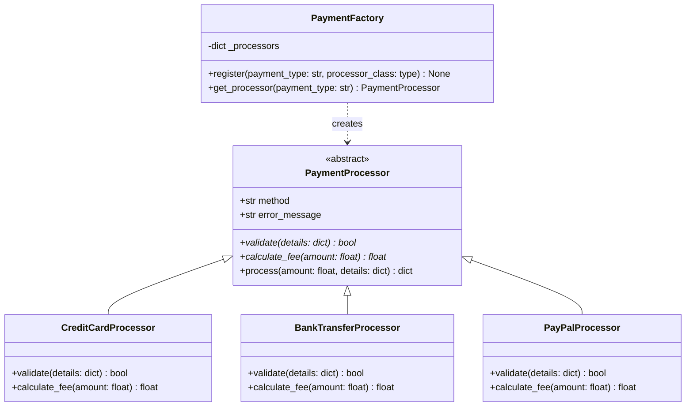
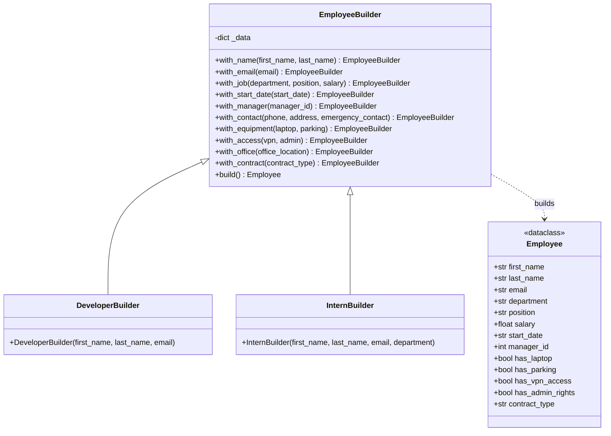
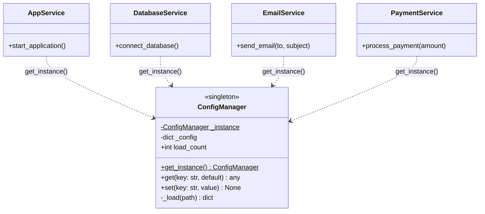

# Creational patterns — UML class diagrams

The statement asks to draw the class diagram before coding. These are the
diagrams I used for `factory.py`, `builder.py` and `singleton.py`.

## 1. Factory — payment system

**Why it is better:** to add Apple Pay, I write an `ApplePayProcessor` class
and call `factory.register("apple_pay", ApplePayProcessor)`. No existing class
is modified (Open/Closed principle), and each processor can be tested alone.

## 2. Builder — employee onboarding

**Why it is better:** every `with_...` method returns `self`, so the creation
reads like a sentence, and there are no more unnamed `None, False, True`
arguments to put in the right order. The validation lives in one place
(`build()`), and the presets guarantee that a developer always gets admin
rights and an intern never does.

## 3. Singleton — configuration manager

(Underlined/`$` members are static: they belong to the class, not to an object.)

**Problems solved:**
1. *File read on every call* → the file is read once, on the first `get_instance()`.
2. *No shared state* → every service receives the same object.
3. *Changes not synchronized* → `set()` changes the shared object, so every service sees it.
4. *Hard to mock in tests* → there is now a single point (`ConfigManager._instance`) to replace.
