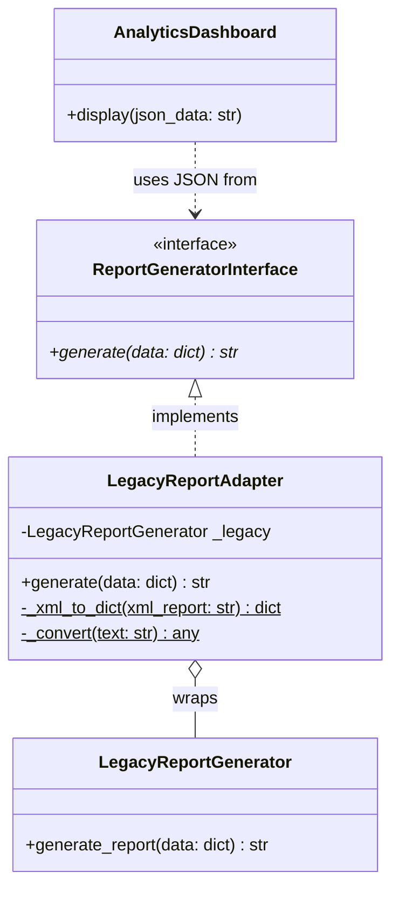
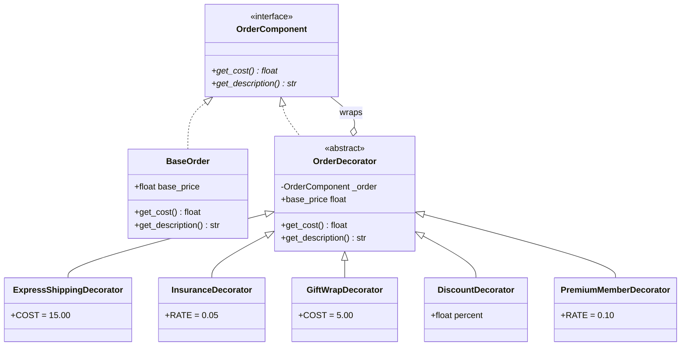

# Structural patterns — UML class diagrams

## 1. Adapter — legacy XML reports in a JSON dashboard

**Problems solved:**
- *Incompatible interfaces* → the adapter exposes `generate()` returning JSON,
  which is what the dashboard expects.
- *Conversion logic repeated* → the XML → JSON translation is written once,
  inside the adapter.
- *Can't modify the legacy system* → we never touch `LegacyReportGenerator`,
  we only wrap it.
- *Tight coupling* → the report functions only know the interface, so the
  legacy system could be replaced by a native JSON generator without
  changing them.

## 2. Decorator — order pricing

The key point is the double link between `OrderDecorator` and
`OrderComponent`: a decorator **is** an order (inheritance) and **has** an
order (aggregation). That is why decorators can be stacked:
`PremiumMemberDecorator(DiscountDecorator(GiftWrapDecorator(...)))`.

**Problems solved:**
- *Boolean flag explosion* → each option is a class; adding one never adds a parameter.
- *Single method does everything* → each decorator has one responsibility.
- *Hard to extend* → a new option is a new decorator, no existing code changes.
- *Can't reuse options* → `InsuranceDecorator` can wrap any order.
- *Order of operations unclear* → the wrapping order **is** the calculation order
  (here the discounts apply after shipping, insurance and gift wrap, which gives
  95.625€ for a 100€ order, the same result as the original code).
