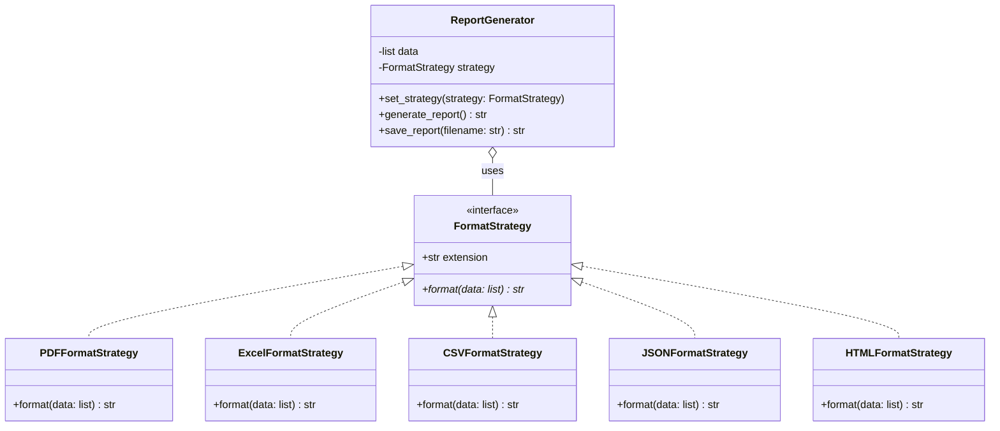
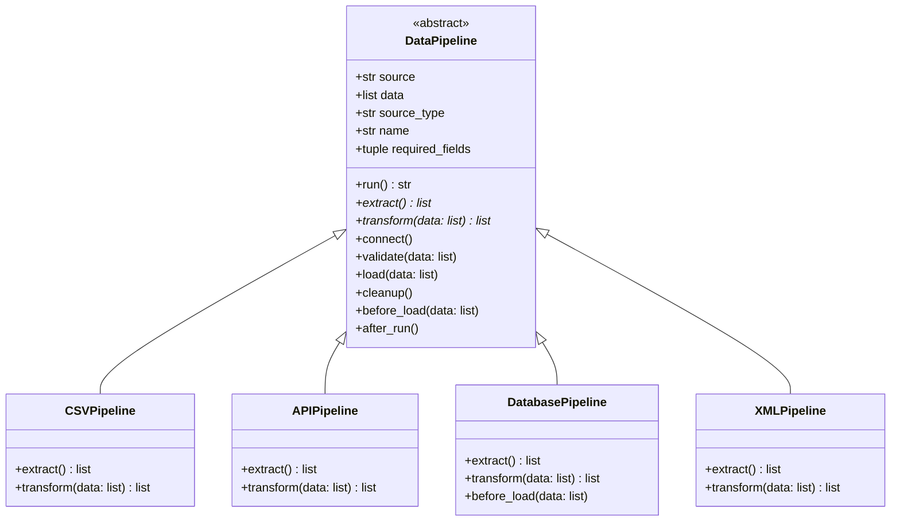

# Behavioral patterns — analysis and UML class diagrams

## 1. Strategy — report formats

**Problems in the original code**
1. Adding a format (XML, Markdown) means modifying `generate_report()` **and**
   `save_report()`: the Open/Closed principle is violated.
2. The format names are repeated in two `if/elif` chains that must stay in sync.
3. No format can be tested alone: everything goes through one big method.
4. The format is a string passed at each call, so there is no clean way to
   choose a format once and change it at runtime.

`HTMLFormatStrategy` was added last without modifying any other class, which
shows the design is open for extension and closed for modification.

## 2. Template Method — ETL pipelines

**Problems in the original code**
1. The validation and cleanup logic is copied 3 times (once per pipeline).
2. Adding logging to every pipeline means editing 3 `run()` methods.
3. Changing the order of the workflow means editing 3 classes, with the risk
   that one pipeline ends up with a different order.
4. Most of each class is duplicated: only extraction and transformation differ.

- `run()` is the **template method**: it fixes the order connect → extract →
  transform → validate → load → cleanup, so no pipeline can skip a step.
- `extract()` and `transform()` are **abstract**: each pipeline must write them.
- `before_load()` and `after_run()` are **hooks**: they do nothing by default,
  and `DatabasePipeline` overrides `before_load()` to print its total.

**Strategy vs Template Method:** both remove `if/elif` and duplication, but
Strategy uses **composition** (the generator *has* a strategy that can be
swapped at runtime), while Template Method uses **inheritance** (the subclass
*is* a pipeline and fills in the steps of a fixed algorithm).
